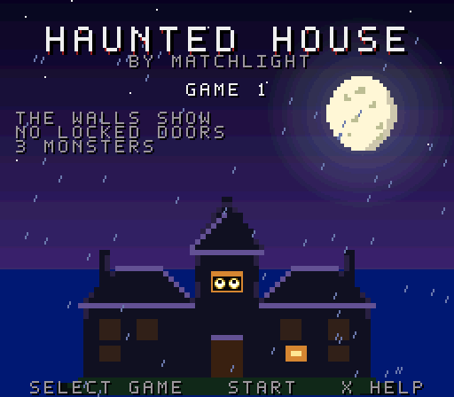
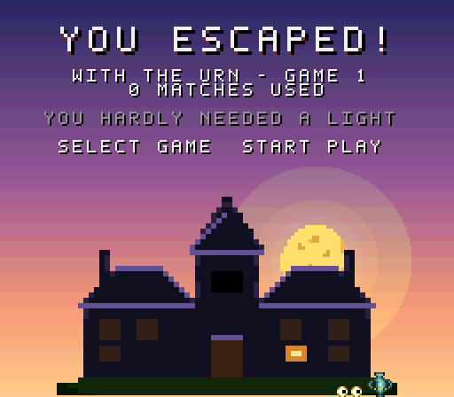
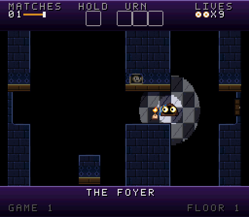
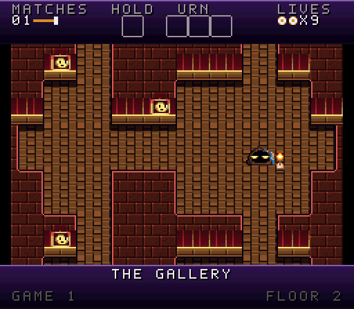
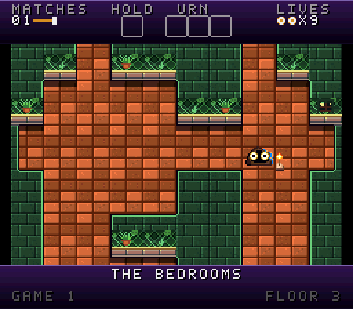
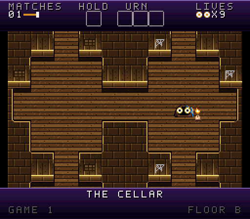

# Haunted House: By Matchlight (Super Nintendo)

A native Super Nintendo game of the Atari 2600 *Haunted House* (James Andreasen, 1982): the same game, rule for rule, in the
[NES game](https://github.com/majonesmax/haunted-house-nes)'s mansion - a cellar and four floors - drawn the
way the [Haunted House remaster](https://github.com/majonesmax/haunted-house-remastered)'s SNES look draws it,
and played on its orchestra. It runs on any SNES emulator, or a real SNES from a flash cartridge.

**[▶ Play it in your browser](https://majonesmax.github.io/haunted-house-snes/)** - nothing to install.

<p>
  
  
</p>
<p>
  
  
</p>
<p>
  
  
</p>

The title; the ending, out at dawn; the Foyer as you play it, by matchlight; and three floors with the
lights-on cheat on, so the whole floor shows - the Gallery, the Bedrooms and the Cellar.

**Download** the ROM from the [releases](../../releases): `haunted_house.sfc`.

Find the three pieces of the urn and carry the whole urn out of the front door, in the dark, with only
matches to see by, while a ghost, a bat and tarantulas roam the house. Nine games, from easy to hard, as the
original has them.

## Playing

| Button | |
|---|---|
| D-pad | walk |
| B or A | light a match; put down what you hold |
| Start | start a game (RESET) |
| Select | choose the game, 1-9 |
| X | on the title, the help; in play, a hint: what to look for next, and which way |
| B + Select | the lights-on cheat: every room lit, everything on the floor shown |

Any button ends the story at the start. Notes come by themselves in the band below the view: when the urn is
whole, when taking something puts down what you held, and when the cheat goes on or off.

What the SNES adds to the NES game: a match's light that fades at its edge, by the console's colour maths;
lightning that washes the walls pale; a storm over the title, with rain and thunder; the screen warming to the
light outside as you escape; and the remaster's orchestra - organ, harpsichord, strings, harp, bell, brass and
timpani - as samples on the SNES's sound chip, for the songs and the twenty sound effects.

## How it's made

- **The rules** are the remaster's [specification](https://github.com/majonesmax/haunted-house-remastered/blob/main/docs/spec.md)
  of the original, and its model of the whole game, which predicts the original's every byte on every frame.
  The engine is written from them in C (`src/`), with a little assembly where speed needed it - not from the
  original's code, nor the NES game's.
- **The check** plays the ROM in an emulator beside the model, with the same controls, and compares the
  game's state after every frame: `tests/verify_engine.py`. It's exact. Other checks compare every sound
  effect and every hint with the remaster's own rules.
- **The mansion** is the NES game's, drawn as text in its repository; this one reads it at build time.
- **The art and music** are the remaster's: its *nocturne* pack, its SNES look's title and ending, and its
  soundtrack, arranged for the SNES by `tools/make_pictures.py`, `tools/make_screens.py` and
  `tools/make_songs.py`.

There's a second build, the **faithful** one, with the original's own mansion read from your copy of the 2600
game when you build it. It proves the engine plays exactly like the original; it's never shared, and nothing
from the 2600 game is in this repository or in the shareable ROM.

[The plan](docs/plan.md) has the whole story, step by step, and [the decisions](docs/decisions.md) say why.

## Building

It's built from three repositories side by side: this one, the remaster and the NES game.

```sh
git clone https://github.com/majonesmax/haunted-house-snes
git clone https://github.com/majonesmax/haunted-house-remastered haunted-house
git clone https://github.com/majonesmax/haunted-house-nes
cd haunted-house-snes
python3 -m venv .venv && .venv/bin/pip install -r requirements-dev.txt
.venv/bin/python tools/get_tools.py      # PVSnesLib, the audio driver and the snes9x core, at pinned versions
cargo build --release -p tad-compiler --manifest-path tools/tad/Cargo.toml   # the audio driver's compiler (Rust: rustup.rs)
.venv/bin/python tools/build.py          # build/shareable/haunted_house.sfc
.venv/bin/python tools/play.py           # play it here, with the keyboard
.venv/bin/python tests/verify_engine.py --shareable   # it plays exactly as the model says
```

Keys in `tools/play.py`: arrows walk, Space lights a match or puts down what you hold, Enter starts a game, Tab
chooses it (1-9), Z gives a hint (the help, on the title), O is the lights-on cheat, Escape quits.

**The faithful build** - the original's own mansion, built from your copy of the 2600 game and never shared:
[docs/faithful-build.md](docs/faithful-build.md) has the recipe.

## License

The code is MIT (`LICENSE`); the art and music are CC BY 4.0 (`LICENSE-ASSETS.md`). *Haunted House* itself is
© 1982 Atari, by James Andreasen.
